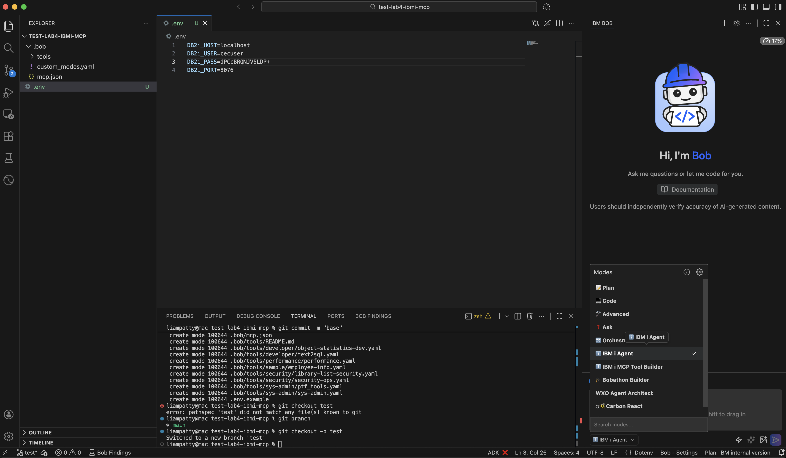

# Lab 101-4: IBM i modes, IBM i MCP, Bob Shell - 15 Minute Hands-On Lab

**Duration**: 15 minutes  
**Level**: Intermediate  
**Prerequisites**: 
- IBM Bob installed and running
- Access to an IBM i system with Mapepire server running (port 8076)
- Basic familiarity with command line

## Lab Overview

In this hands-on lab, you'll configure IBM Bob to work with IBM i systems using the Model Context Protocol (MCP). You'll set up custom modes, connect to your IBM i system, and execute your first queries using Bob's AI-powered interface. 

The *IBM Bob premium package for IBM i* available at GA will bring standard IBM i modes and tools that will differ from the ones used in this tutorial. 

## What You'll Learn

- How to configure Bob for IBM i development with MCP and modes
- How to use IBM i-specific AI agent modes
- How to query IBM i systems using natural language
- How to leverage pre-built IBM i tools

## Lab Setup (5 minutes)

### Step 1: Open project

Open up the `lab4-ibmi-mcp` folder in a new Bob window, this is the participant working directory.

### Step 2: Configure IBM i Connection

1. Configure port forwarding to create an SSH tunnel between local port 8076 and the IBM i server

```bash
   ssh -i PATH/TO/pem_user_privatekey_download.pem \
   -L 8076:localhost:8076 \
   -o ServerAliveInterval=15 \
   -o ServerAliveCountMax=3 \
   cecuser@<IBMi_IP_ADDRESS>
```

2. Create a `.env` file in your project root with your IBM i credentials:

```bash
# .env file
DB2i_HOST=localhost
DB2i_USER=YOURUSER
DB2i_PASS=yourpassword
DB2i_PORT=8076
```

### Step 3: Check configuration

1. Open up Bob settings
2. Check that `ℹ️ IBM i Agent` and `ℹ️ IBM i MCP Tool Builder` appear in your modes list
3. Check that `ibmi-mcp-server` and `ibmi-mcp-docs` appear connected in your MCP list

### Optional: Use Bobshell
If you want to run this lab through Bob shell rather than Bob IDE, see [./lab4-ibmi-optional-bobshell](./lab4-ibmi-optional-bobshell)

## Exercise 1: Switch to IBM i Agent Mode (2 minutes)

**Objective**: Select the IBM i-specific AI agent.

1. Switch to IBM i Agent mode


2. Ask Bob: `What can you help me with?`
   - Bob should describe its IBM i capabilities
   - You may need to reload the window to refresh the credentials for the MCP server: `CMD` `SHFT` `P`, search `Developer: Reload Window`

## Exercise 2: Query System Status (3 minutes)

**Objective**: Use Bob to check your IBM i system's performance.

1. Ask Bob: `Show me the current system status`
2. Bob should execute the `system_status` tool and display:
   - System Information
   - Job Activity
   - Processing Resources
   - Memory & Storage
   - Job Table
   - System Configuration

**Additional Questions to Try**:
- `What is the current CPU usage?`
- `How many jobs are currently active?`
- `Show me memory pool information`

## Exercise 3: Explore Database Objects (3 minutes)

**Objective**: Use Bob to explore your IBM i database.

1. Ask Bob: `List all service categories available on IBM i`
   -  Bob should show categories like "System Administration", "Performance", "Security", etc.
2. Ask Bob: `Search for services related to 'job' in their name`
   -  Bob should list job-related SQL services

**Additional Questions to Try**:
- `What services are available in the Performance category?`
- `Show me an example of using the ACTIVE_JOB_INFO service`
- `List tables in the QSYS2 schema`

## Exercise 4: Security Analysis

**Objective**: Use Bob to perform a basic security check.

1. Ask Bob: `Show me users with limited capabilities`
   - Bob should execute the security tool and display results
3. Ask Bob: `Are there any database files readable by any user?`

**⚠️ Note**: These queries require appropriate security authorities on your IBM i system.


## What You've Accomplished

Congratulations! You've successfully:

1. ✅ Configured IBM Bob for IBM i development
2. ✅ Connected Bob to your IBM i system via MCP
3. ✅ Used natural language to query IBM i system information
4. ✅ Explored IBM i SQL services and database objects
5. ✅ Leveraged pre-built tools for system monitoring

## Next Steps   

### Create Custom Tools

Switch to IBM i MCP Tool Builder mode:

1. Ask Bob: `Switch to IBM i MCP Tool Builder mode`
2. Ask Bob: `Help me create a tool to monitor job queues`
   - Bob will guide you through creating a custom YAML tool definition
3. Ask Bob: `Run the new tool`
   - - You may need to reload the window to load the MCP server updates: `CMD` `SHFT` `P`, search `Developer: Reload Window`


### Learn More

- [IBM i MCP Server Documentation](https://ibm-d95bab6e.mintlify.app/)
- [Mapepire Setup Guide](https://mapepire-ibmi.github.io/guides/sysadmin/)
- [SQL Tools Guide](https://ibm-d95bab6e.mintlify.app/sql-tools/overview)
- [GitHub Repository](https://github.com/IBM/ibmi-mcp-server)

## Troubleshooting

### MCP server connection fails
- Verify `.env` file has correct credentials
- Ensure Mapepire is running on IBM i (port 8076)
- Test connectivity: `ping your-ibmi-hostname`
- Check firewall allows port 8076

### Tools return errors
- Verify your IBM i user has appropriate authorities
- Check Mapepire server logs on IBM i
- Ensure QSYS2 services are available on your system

### No data returned
- Confirm you're querying existing objects/schemas
- Check SQL syntax in tool definitions
- Verify database authorities for your user profile

## Feedback

This lab is part of the IBM i MCP Server project. If you have suggestions or find issues, please contribute at [GitHub](https://github.com/IBM/ibmi-mcp-server).

---

**Lab Complete!** You're now ready to use IBM Bob for IBM i development and system administration tasks.