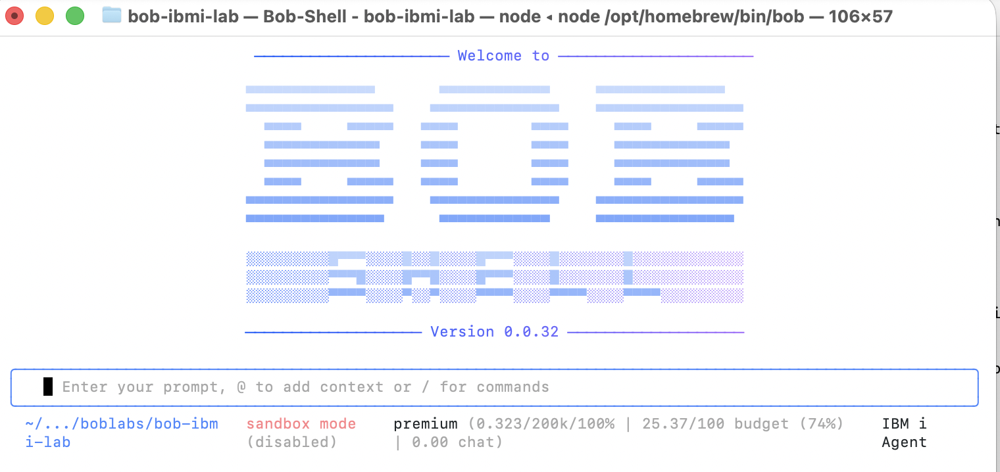
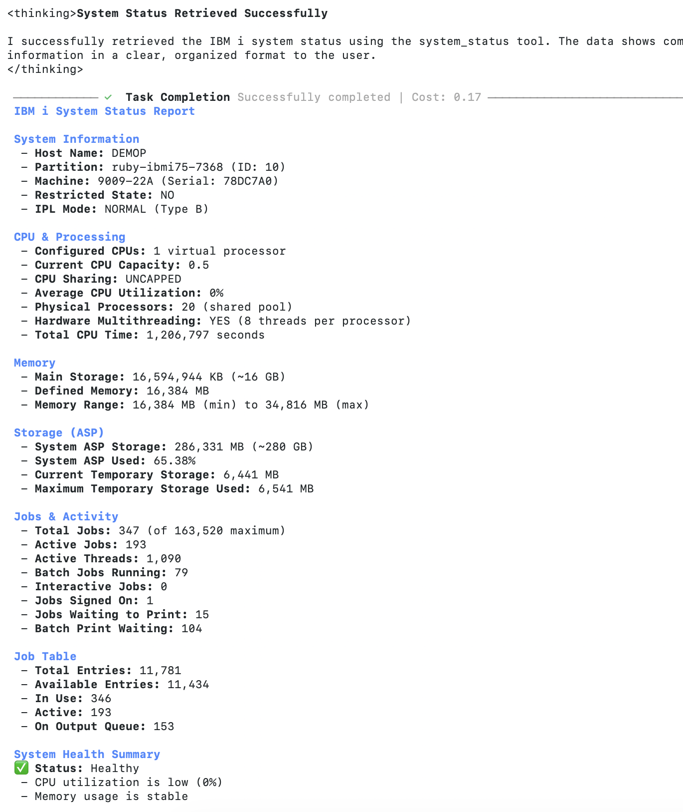

# Lab 4 using Bob CLI (3 minutes)

**Objective**: Learn to use Bob from the command line for general IBM i assistance.

Bob provides a CLI that allows you to interact with AI agents from the terminal, making it perfect for quick questions, code generation, and documentation lookup.

## Lab Completion Checklist

- [ ] Bob is configured with IBM i custom modes
- [ ] MCP servers are connected and working
- [ ] Successfully switched to IBM i Agent mode
- [ ] Retrieved system status information
- [ ] Explored IBM i services and database objects
- [ ] (Optional) Ran security analysis queries
- [ ] Used Bob CLI from the command line

### Step 1: Open the folder and verify Bob CLI is Available

Navigate to the lab4-ibmi-mcp folder in your terminal and check if Bob CLI is installed:
```bash
bob --version
```

If not installed, follow the Bob CLI installation instructions for your platform.

### Step 2: Update MCP Configuration for CLI

Bob CLI can require a few changes in the MCP configuration. Update your `.bob/mcp.json` : 

1. **Find the full path to npx**:
```bash
which npx
# Example output: /opt/homebrew/bin/npx
```

2. **Get the full path to your project directory**:
```bash
pwd
# Example output: /Users/yourname/bob-ibmi-lab
```

3. **Update `.bob/mcp.json`** with full paths, e.g.

```
{
    "mcpServers": {
        "ibmi-mcp-server": {
            "command": "npx",
            "args": [
                "@ibm/ibmi-mcp-server",
                "--tools",
                "/Users/liampatty/Documents/bob/bob sldc/bob-for-rpg-workflow/test-lab4-ibmi-mcp/.bob/tools"
            ],
            "cwd": "/Users/liampatty/Documents/bob/bob sldc/bob-for-rpg-workflow/test-lab4-ibmi-mcp",
            "env": {
                "NODE_OPTIONS": "--no-deprecation --no-warnings",
                "MCP_TRANSPORT_TYPE": "stdio",
                "YAML_ALLOW_DUPLICATE_SOURCES": "true"
            },
            "disabled": false,
            "alwaysAllow": []
        },
        "ibmi-mcp-docs": {
            "type": "streamable-http",
            "url": "https://ibm-d95bab6e.mintlify.app/mcp"
        }
    }
}
```

### Step 3: Check Available Modes

Verify that Bob CLI can see your custom modes:

```bash
bob mcp list
```

You should see:
```
Configured MCP servers:

...
✓ ibmi-mcp-server: npx @ibm/ibmi-mcp-server --tools /Users/liampatty/Documents/bob/bob sldc/bob-for-rpg-workflow/test-lab4-ibmi-mcp/.bob/tools (stdio) - Connected
✓ ibmi-mcp-docs: https://ibm-d95bab6e.mintlify.app/mcp (http) - Connected
```

### Step 4: Use Bob Shell with IBM i Agent Mode

Launch Bob shell and interact with IBM i using the custom mode:

1. **Start Bob shell**:
```bash
bob 
```



2. **Switch to the ibmi mode**:
```
/mode ibm-i-agent
```
Bob should confirm the mode switch.

3. **Run a query in advanced mode**:
```
Show me the current system status
```

Bob should execute the `system_status` tool and display comprehensive IBM i system information including CPU, memory, jobs, and storage statistics.

4. **Exit Bob shell**:
```
Exit Bob shell with Ctrl+C Ctrl+C
```

**✅ Success Criteria**:
- Bob shell launches successfully
- Successfully switch to IBM i Agent mode
- Execute queries and receive IBM i system data
- Understand the difference between shell (interactive) and CLI (one-shot) usage

### Step 5: Run Live IBM i Queries from Command Line

With the MCP server connected, you can now run live queries against your IBM i system:

```bash
# System status
Show me the current system status

# Active jobs
Show me the top 5 CPU consumers

# Database exploration
List tables in the SAMPLE schema

# Security checks
bob -p "Show me users with limited capabilities
```
<br>



### CLI Options Reference

Common Bob CLI options:
- `--chat-mode <mode>` - Specify chat mode: `plan`, `code`, `ask`, or `advanced`
- `--hide-intermediary-output` - Suppress extra output, show only final results
- `--max-coins <number>` - Set maximum cost limit (exits with code 1 if exceeded)
- `--help` - Show all available options
