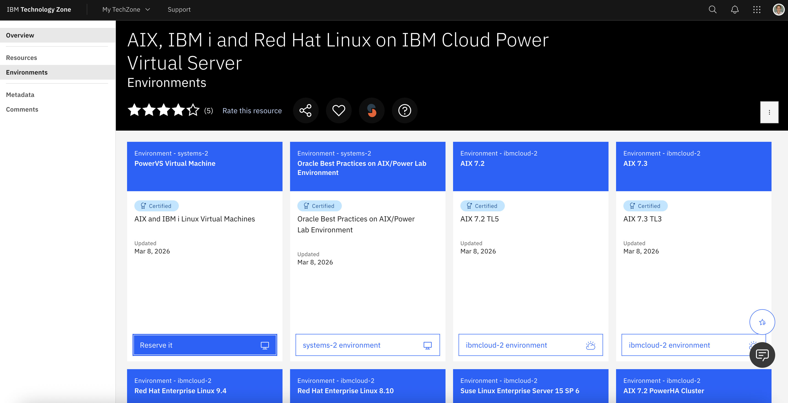
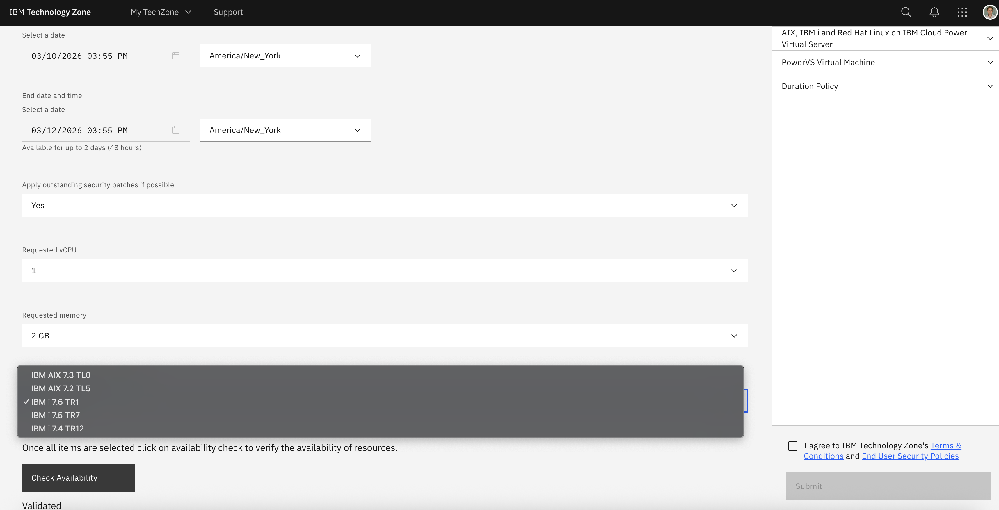
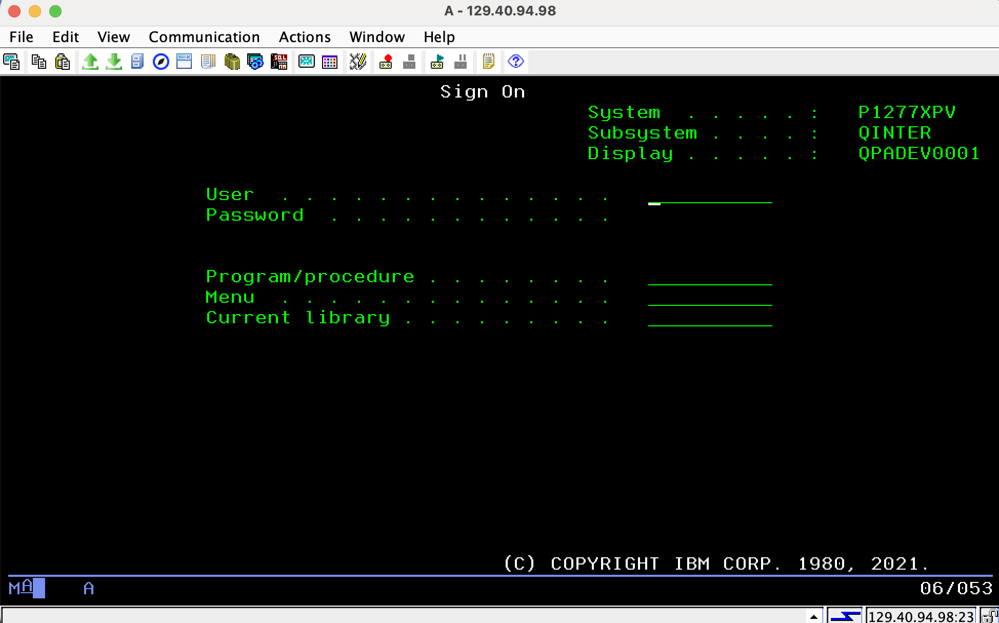
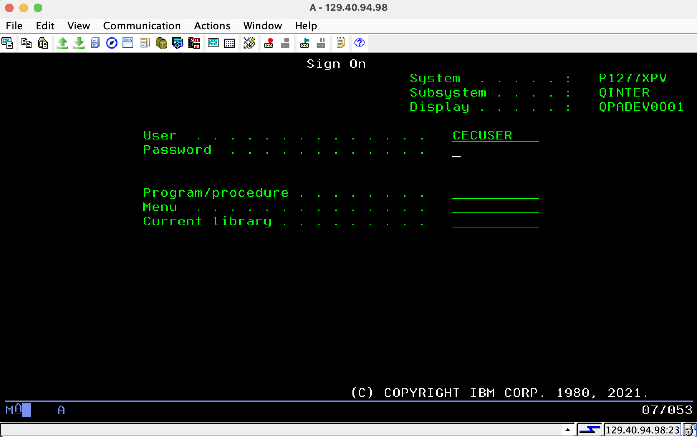
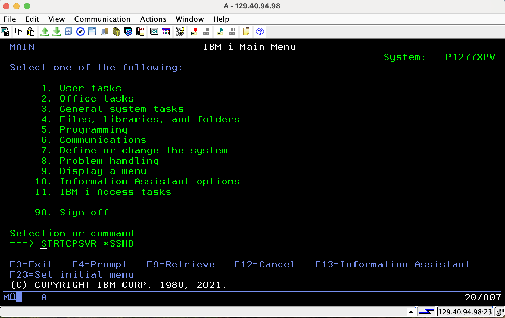
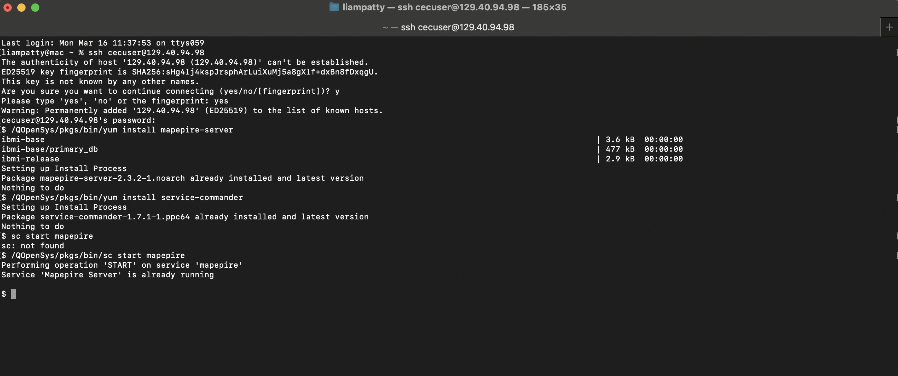

# Instructor Guide for Lab 4

## How to get an IBM i virtual machine (aka LPAR)? 

* For customer activities: 
    * (1A) Use customer infrastructure (IBM on prem or in the Cloud)
    * (1B) TechZone: request an [IBM i on IBM Cloud Power Virtual Server](https://techzone.ibm.com/collection/628be988043b54001f89111f) with ssh tunneling (see instructions [here](https://cloud.ibm.com/docs/power-iaas?topic=power-iaas-connect-ibmi#ssh-tunneling) for opening ports if using a public IP. Note that no 'production' customer data is allowed when using our own IBM accounts. Please refer to the official guidelines.
    * (1C) TechZone: request a custom techZone environment for complex or more permanent showcase (prefered but not the default). 
* For IBMers/business partners activities:
    * (2A) TechZone: request a ["On-Premises IBM Power AIX, IBM i and Linux Base Images"](https://techzone.ibm.com/collection/6261d3584670d7001e3d483a) environment, for example IBM i 7.5 on Power10. IBMers must connect through the Internal intranet and Business partners must connect through a provided VPN.
    * (2B) TechZone: request a [IBM i on IBM Cloud Power Virtual Server](https://techzone.ibm.com/collection/628be988043b54001f89111f) as listed above.

For PowerVS TZ reserations, ensure you select the IBM i server:

 

## How to start the mapepire service on IBM i used by MCP? 
Mapepire is an open-source, lightweight database connector designed to facilitate secure, fast access to Db2 for IBM i from modern application environments like Node.js, Python, and .NET Core. It uses Secure WebSockets over a single, configurable port, eliminating the need for complex, native, or JDBC/ODBC dependencies.

### Option 1 (faster): Via SSH into RHEL

1. Download OS User Private SSH Key from the TechZone instance, note the `OS User Account`, `RHEL VM IP Address`, `IBM i VM IP Address`, and `OS User Password`

2. SSH into the IBMi:
    `ssh -i path/to/user_private_key_download.user <OS_USER_NAME>@<IBMi_IP_ADDRESS>`

3. On the IBM i host, verify that yum exists:
   `ls -l /QOpenSys/pkgs/bin/yum`

4. Install service-commander:
   `/QOpenSys/pkgs/bin/yum install service-commander`

5. Install mapepire-server:
   `/QOpenSys/pkgs/bin/yum install mapepire-server`

6. Start the Mapepire service:
   `/QOpenSys/pkgs/bin/sc start mapepire`

7. Check the status:
   `/QOpenSys/pkgs/bin/sc status mapepire`

Note that in the command above, port 8076 is the default **mapepire** port. If you have changed it, please update it accordingly. Replace `<myuser>` and `<myIPaddress>` with your IBM i user and IP address. If you are on mac, you may need to use `sudo` because on macOS, ports below 1024 are considered "privileged." Your Mac is blocking the SSH client from grabbing port 449 which IBM i uses for the Server Mapper for security reasons.

### Option 2: Using IBM i Access Client Solutions

Follow these [instructions](https://ibm-d95bab6e.mintlify.app/setup-mapepire#option-1-rpm-installation-recommended):
1. Download Access Client Solution from [this link](https://www.ibm.com/resources/mrs/assets?source=swg-ia)
2. Follow the [quickstart guide](https://www.ibm.com/support/pages/ibm-i-access-acs-quick-start-guide)
    - Locate the Mac_Application folder within the download
    - Double click install_acs, if necessary, navigate to your system security settings to bypass apple scan and "open anyway"
    - A terminal will open requesting your system password
3. Customize install according to the prompts and wait for install to complete
4. Check your Applications folder and open `IBM i Access Client Solutions`, it will look like:

    

    
    

5. Connect to your IBM i with [Access Client Solution](https://www.ibm.com/support/pages/ibm-i-access-client-solutions) (5250 emulator) and your user profile.
    - Select `System Configurations` in the left pane
    - Press `New`
    - In the `System Name` field, add the `IBM i VM IP address` from TechZone
    - Add a description, e.g. "IBM i for bobathon"
    - Press `Okay` to save
    - Navigate back to the main window and select the new system in the `System` dropdown
    - In the left pane, select `5250` emulator
    - You will be prompted to sign in, the user credentials are the `OS User Account` and `OS User Password` from TechZone
    - You will need to sign in again, type in your username and paste the password on the line below

    

    

6. Start SSH using the CL command `STRTCPSVR *SSHD` , 

    

7. Now you can SSH in on your local terminal and install/start mapepire
    - `ssh OS_USER_NAME@IP_ADDRESS`
    - `/QOpenSys/pkgs/bin/yum install mapepire-server`
    - `/QOpenSys/pkgs/bin/yum install service-commander`
    - `/QOpenSys/pkgs/bin/sc start mapepire`

    

8. Feel free to close out the 5250 emulator

9. If using a TechZone [IBM i on IBM Cloud Power Virtual Server](https://techzone.ibm.com/collection/628be988043b54001f89111f), create the ssh tunnel using the following command on your Linux/MacOS laptop (for Windows, please use the reference [here](https://cloud.ibm.com/docs/power-iaas?topic=power-iaas-connect-ibmi#ssh-tunneling)). This allows your laptop to talk to the IBM i database and admin tools directly.

